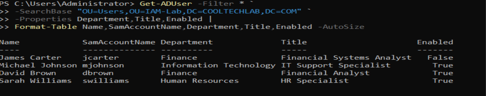
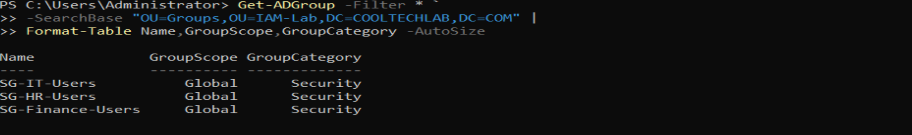
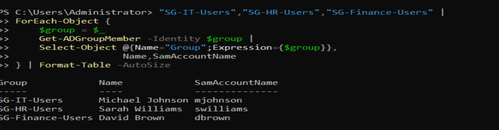
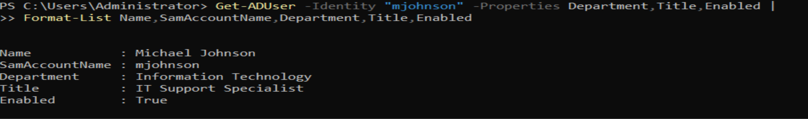
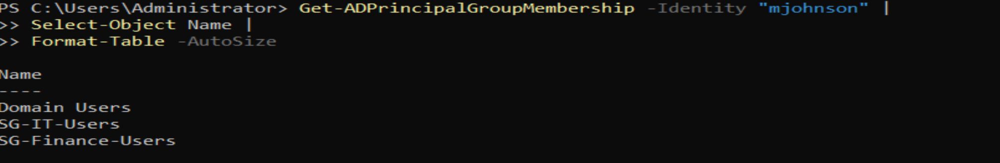
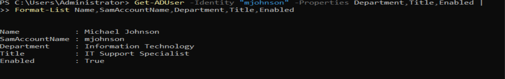
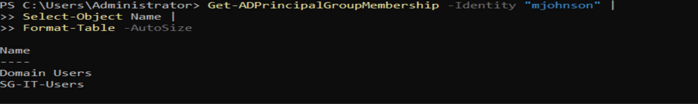

# IAM-UAR-001 — Excessive Departmental Access Review

**Type:** Simulated quarterly User Access Review / Access Certification  
**System:** On-premises Active Directory, `COOLTECHLAB.COM`  
**Finding:** Excessive Finance security group membership for an IT employee  
**Status:** AD group-level remediation verified

## Objective

Evaluate departmental access assignments against the fictional employee's role, record an access certification decision, remove an inappropriate membership, and validate the outcome.

## Baseline inventory

PowerShell account enumeration returned:

| Account | Department | Account state |
| --- | --- | --- |
| James Carter (`jcarter`) | Finance | Disabled (prior Leaver lab) |
| Michael Johnson (`mjohnson`) | Information Technology | Enabled |
| Sarah Williams (`swilliams`) | Human Resources | Enabled |
| David Brown (`dbrown`) | Finance | Enabled |

Three global security groups were present: `SG-IT-Users`, `SG-HR-Users`, and `SG-Finance-Users`.

Approved baseline group memberships, verified by PowerShell:

| Group | Member |
| --- | --- |
| `SG-IT-Users` | Michael Johnson |
| `SG-HR-Users` | Sarah Williams |
| `SG-Finance-Users` | David Brown |

## Controlled finding introduction

For this isolated lab, the following command was used to deliberately create a discrepancy:

```powershell
Add-ADGroupMember -Identity "SG-Finance-Users" -Members "mjohnson"
```

This is a **simulated provisioning error**, not an incident discovered in production.

## Investigation evidence

```text
Name           : Michael Johnson
SamAccountName : mjohnson
Department     : Information Technology
Title          : IT Support Specialist
Enabled        : True

Name
----
Domain Users
SG-IT-Users
SG-Finance-Users
```

**Assessment:** `SG-Finance-Users` was outside the fictional approved access baseline for Michael's IT role. It represented excessive *group membership* and a potential least-privilege concern. Actual Finance resource authorization was not tested.

## Access certification decision

The lab modeled a Finance resource-owner review with a **simulated decision to revoke** `SG-Finance-Users` and retain `SG-IT-Users`. No real manager or owner approval was collected.

See [certification record](IAM-UAR-001-certification-record.md).

## Remediation

```powershell
Remove-ADGroupMember -Identity "SG-Finance-Users" -Members "mjohnson" -Confirm:$false
```

## Post-remediation verification

The user provided the following PowerShell output:

```text
Name           : Michael Johnson
SamAccountName : mjohnson
Department     : Information Technology
Title          : IT Support Specialist
Enabled        : True

Name
----
Domain Users
SG-IT-Users
```

**Verified result:** The Finance group no longer appears in the account's returned group membership; the IT group remains, and the account remains enabled.

## Evidence screenshots (uploaded and linked)

- `screenshots/01-uar-existing-users.png` — baseline account inventory
- `screenshots/02-uar-security-groups.png` — departmental groups
- `screenshots/03-uar-current-memberships.png` — approved baseline
- `screenshots/04-uar-excessive-access-user-attributes.png` — user attributes during finding
- `screenshots/05-uar-excessive-access-group-membership.png` — excessive group membership
- `screenshots/06-uar-after-remediation-user-status.png` — account state after removal
- `screenshots/07-uar-after-remediation-group-membership.png` — membership after removal

## Scope limitations

No Entra ID synchronization, application-specific permission checks, session revocation, or interactive sign-in testing was performed. AD group membership is not proof of effective resource access.

## Evidence gallery

### Account inventory


### Departmental security groups


### Approved group membership baseline


### Finding — employee attributes


### Finding — excessive Finance membership


### Remediation — account status


### Remediation — authorized group retained

